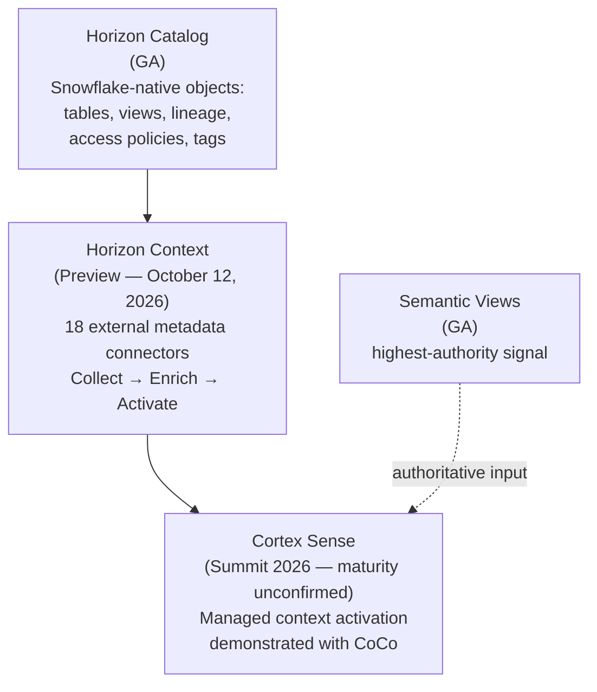

# Horizon Context + Cortex Sense: The Context Stack Explained

[Horizon Context](https://docs.snowflake.com/en/user-guide/snowflake-horizon/horizon-context) collects, enriches, and activates metadata across Snowflake and external systems. Its October 12, 2026 preview adds 18 metadata connectors, external metadata curation, and column description propagation. This guide separates those documented capabilities from the announced [Cortex Sense](https://www.snowflake.com/en/blog/enterprise-ai-agents-grounded-context/) runtime layer, and explains why metadata visibility, data access, and agent tool configuration are different controls.

**Audience:** SEs and platform owners who have deployed Cortex Agents or semantic views and need to know what the context layer does to their existing access-control model.
**Created:** 2026-07-09 | **Last updated:** 2026-10-13 | **Expires:** 2026-11-28 | **Status:** ACTIVE

**Last verified:** 2026-10-13 (October release changes below); full-guide review: 2026-09-29.

Pair-programmed by SE Community + Cortex Code

> **No support provided.** Reference only; validate before production use.

> **October update:** **2026-10-13** — Horizon Context preview, connector access and security, metadata curation, lineage updates, Semantic Studio GA, and agent-control qualifications. See [Availability Summary](#availability-summary) for feature-specific evidence. Cortex Sense availability is not established by Horizon Context's release. Benchmark figures are from Snowflake's internal tests, not guaranteed customer results.

---

## Start Here

Use this guide in three passes:

1. Read **The Three-Layer Stack** to separate Horizon Catalog, Horizon Context, and Cortex Sense. These are three different things and customers routinely conflate them.
2. Read **The Agent Security Boundary** before discussing regulated or least-privilege deployments. This is the durable core of the guide.
3. Check **Availability Summary** and the connector security prerequisites before choosing a dependency. Open preview does not mean every cloud, region, or source configuration is supported.

Treat announced roadmap behavior, current product availability, and documented Cortex Agent controls as three separate categories of fact. This guide marks the boundaries between them explicitly.

Ready to act? Use [What Can I Do Now?](docs/01-WHAT-CAN-I-DO-NOW.md) for decision checkpoints and links to maintained setup instructions.

---

## Vocabulary

| Term | Plain meaning |
| --- | --- |
| **Horizon Catalog** | Snowflake's governance and discovery catalog for native and external assets. Horizon Context is its governed context layer. |
| **Horizon Context** | Collects, enriches, and activates metadata, including external BI tools, databases, and pipelines. Preview release dated October 12, 2026. |
| **Metadata Connector** | A built-in integration that ingests schemas, query logs, and dashboard definitions from an external system into Horizon Catalog. |
| **Semantic View** | A Snowflake object defining business metrics, dimensions, and relationships over raw tables. Used by Cortex Analyst to answer natural-language questions. |
| **Cortex Sense** | Announced as a managed runtime context layer, demonstrated with CoCo. Dedicated public availability and retrieval-access documentation was not found in this review; see [Availability Summary](#availability-summary). |
| **Cortex Analyst** | The Snowflake service that generates SQL from natural language using a semantic view as its business logic layer. |
| **CoWork** | Snowflake's business-user-facing agent interface, renamed from Snowflake Intelligence at Summit 2026. The `SNOWFLAKE_INTELLIGENCE` database identifier used in DDL is unchanged. |
| **OpenLineage** | An open standard for lineage metadata. Tools such as dbt and Apache Airflow push lineage into Horizon Catalog through Snowflake's external lineage REST endpoint. |
| **Apache Ossie (Incubating)** | The vendor-neutral semantic specification formerly called Open Semantic Interchange (OSI). Accepted into the Apache Incubator under its new name in July 2026. |
| **RBAC** | Role-based access control. Governs which Snowflake roles can access which objects. |
| **GA / Public Preview / Private Preview** | Snowflake maturity labels. Public/open preview permits broad participation but can still have cloud, region, edition, or enablement limits. Private preview requires approved access. Check each feature's requirements separately. |

---

## Why a Context Layer Exists

Your head of sales sees $14.2 million in Q3 revenue. Your CFO sees $12.8 million. Both asked an AI agent the same question this morning. This is metric drift — business logic scattered across a BI model only one team owns, a calculation buried in a dashboard, instructions hardcoded into a prompt. *(Opening scenario from [Snowflake's Horizon Context announcement](https://www.snowflake.com/en/blog/horizon-context-governed-context/).)*

A catalog that is a passive inventory does not fix this. It tells a human where to look. An agent answering a question needs the governed definition handed to it at the moment it is asked, and needs to be told which of several competing definitions is authoritative.

That gap — passive inventory versus active runtime context — is what this stack addresses.

---

## The Three-Layer Stack



Each layer has a distinct job:

- **Horizon Catalog** — the governed inventory of everything Snowflake knows about your data.
- **Horizon Context** — expands that inventory to external systems and enriches raw metadata into business meaning.
- **Cortex Sense** — the layer Snowflake demonstrated making enriched context active at query time for CoCo, retrieving relevant context instead of inspecting the estate table by table.

This diagram is a conceptual separation, not a required product dependency chain. Horizon Context serves catalog users, CoCo, semantic-view-backed agents, and BI consumers without requiring a claim about Cortex Sense availability. Permissions matter at every stage: what is collected, who can see or edit metadata, and what each execution tool can read or change.

---

## Horizon Context in Detail

Horizon Context organizes its work into three phases. Its documentation distinguishes **structural** context (objects and lineage), **operational** context (freshness and quality), **semantic** context (business definitions), and **behavioral** context (usage and popularity).

### Collect

The [October 12 preview](https://docs.snowflake.com/en/release-notes/2026/other/2026-10-12-horizon-context-preview) introduced **18 metadata connectors in open preview**, covering BI tools, databases, and dbt. Use the maintained [connector catalog](https://docs.snowflake.com/en/user-guide/snowflake-horizon/connectors) for the current list and source-specific setup; this guide does not duplicate it. These are metadata connections, not business-data replication pipelines, and nothing connects automatically.

**Check eligibility before designing around a connector.** The release lists AWS/Azure commercial regions, not every Snowflake region. Source permissions and refresh behavior vary by connector. Read the [security requirements](https://docs.snowflake.com/en/user-guide/snowflake-horizon/connectors/security) before onboarding: they do not guarantee stable egress IPs or uniform TLS enforcement across source types. Do not broaden database network access just to complete setup.

Separately, **[external lineage](https://docs.snowflake.com/en/user-guide/external-lineage)** — the OpenLineage ingestion path — reached **GA on September 3, 2026**. Use it when your producer already emits lineage events; use metadata connectors when you need source-specific catalog collection. Check the external-lineage documentation for edition requirements, authorization, supported events, and capacity limits.

**[Apache Ossie (Incubating)](https://www.snowflake.com/en/blog/apache-ossie-open-semantic-interchange-incubator/)** — formerly Open Semantic Interchange (OSI) — defines a vendor-neutral format for exchanging semantic metadata across catalog vendors, BI tools, query engines, and AI agents. The June 2026 Horizon Context announcement cited 54 participating vendors; the July Apache update describes the coalition as more than 50 organizations.

### Enrich

Once collected, raw metadata is enriched into usable business context:

- **End-to-end column-level lineage** — stitched from Snowflake query logs, external system logs, BI definitions, and OpenLineage feeds. Column-level mappings arrive through the OpenLineage `columnLineage` facet and are resolved best-effort: an unresolvable column is skipped rather than failing the event.
- **Popularity signals** — query and access frequency used to distinguish authoritative assets from experimental ones.
- **Certification status** — the explicit human signal that an asset is trusted. Note the tag moved: `SNOWFLAKE.TAGS.CERTIFICATION_STATUS` arrived in public preview on August 31, 2026 and is now the recommended tag. `SNOWFLAKE.CORE.CERTIFICATION_STATUS` is **still supported and has not been deprecated**, but Snowflake documents it as planned for deprecation in a future release. New work should use the `SNOWFLAKE.TAGS` tag, whose allowed values are fixed by Snowflake and cannot be modified by account administrators — which is what lets governance and AI workflows interpret it consistently.
- **AI-generated documentation** — table and column descriptions generated from metadata and optionally sample data.
- **Metadata curation without ownership** — use [`APPLY COMMENT`](https://docs.snowflake.com/en/user-guide/snowflake-horizon/connectors/access-control#apply-comment) for comment-only stewardship rather than granting broad modification rights. External assets can also be curated in the catalog; follow the source documentation for access requirements.
- **Column comment propagation (open preview)** — [opt-in propagation](https://docs.snowflake.com/en/user-guide/comment-propagation) reduces repeated descriptions where values pass through unchanged. It does not replace documentation for transformed metrics or overwrite manual downstream comments. Check supported objects, lineage eligibility, and disable behavior before enabling it.
- **Semantic Views** — the governed business definition layer. [Semantic View Autopilot](https://docs.snowflake.com/en/user-guide/views-semantic/autopilot) can generate a view from selected tables plus example SQL, and can ingest Tableau `.twb`, `.twbx`, `.tds`, and `.tdsx` files. [Power BI ingestion became GA on August 18, 2026](https://docs.snowflake.com/en/release-notes/2026/other/2026-08-18-semantic-views-power-bi-ingestion-ga) and supports `.pbit` and `.pbix`; report-level measures and time-intelligence functions such as `PREVIOUSMONTH` and `SAMEPERIODLASTYEAR` are not yet fully supported.

### Lineage coverage and limits

[Temporary-object lineage preservation](https://docs.snowflake.com/en/user-guide/lineage-temporary-objects) is **GA since September 21, 2026**. It preserves supported paths through intermediate temporary objects after cleanup; temporary and transient are not interchangeable.

The [October 6 update](https://docs.snowflake.com/en/release-notes/2026/other/2026-10-06-lineage-integrations-monitors-search) expands lineage for storage integrations, external tables, model monitors, and stage-created Cortex Search services. Coverage is not retroactive and depends on the creation path. Check the linked limitations before interpreting a missing edge as proof of no dependency; do not recreate production objects merely to populate the graph.

### Activate

Enriched context is only valuable if it reaches the AI at the right moment:

- **Universal Search** — CoCo's context retrieval uses hybrid keyword plus semantic search, filtered by access control policies, ranked by popularity.
- **Automatic semantic view discovery** — when asked a data question, CoCo searches for and uses relevant semantic views, falling back to direct table access if none exist. That fallback is the behavior to understand before assuming a semantic view constrains what an agent will consult.
- **Semantic View interoperability** — semantic views exposed via MCP allow Claude, Cursor, and other MCP clients to query Snowflake data with governed business logic. Power BI, Excel, ThoughtSpot, and Looker were all named as expanding this ecosystem; none of those four statuses could be confirmed against product documentation for this revision.

---

## Cortex Sense: The Runtime Activation Layer

Horizon Context builds the enriched catalog. Cortex Sense is the managed layer Snowflake demonstrated activating that context for CoCo queries.

Two things to hold steady when discussing it. First, public sources demonstrate Cortex Sense grounding **CoCo**; they do not establish transparent injection into every Cortex Agent, every third-party agent, or arbitrary AI requests. Second, the October 13 review did **not find dedicated public Cortex Sense availability or retrieval-access documentation, or a GA release note**. The [CoCo Desktop v1.21.6 release notes](https://docs.snowflake.com/en/user-guide/cortex-code/cortex-code-desktop/release-notes/v1-21-6) mention a Sense feedback fix; that establishes a documented integration reference, not general availability or a permission contract. Do not infer Sense availability from the Horizon Context preview or assume it is active in a customer account.

### Why It Exists

Snowflake's own product team found that even with Semantic View Autopilot, they had covered [fewer than 5% of their 9,685 internal tables](https://www.snowflake.com/en/blog/enterprise-ai-agents-grounded-context/) with semantic views. Any query outside that 5% got a wrong answer or no answer. Tables created two weeks ago have no semantic view. Cortex Sense is designed to fill that gap.

That statistic is also the most useful diagnostic question to ask a customer: *what percentage of your estate is covered by semantic views today?* If the answer is low, the gap is real regardless of how any benchmark is read.

### How It Works

Cortex Sense builds a working model of the data estate from signals the organization already produces:

- Query history from Snowflake and connected external systems
- Object metadata and table structures
- BI dashboard definitions (Power BI, Tableau) via Horizon Context connectors
- Semantic views — treated as the authoritative, highest-ranked signal

Rather than injecting the full catalog into every prompt, Sense retrieves only the context relevant to the specific query, ranking candidates by relevance, authority, popularity, and freshness.

### Accuracy and Cost (Snowflake Internal Benchmark)

Snowflake published the following from [internal testing on their own product analytics data in June 2026](https://www.snowflake.com/en/blog/enterprise-ai-agents-grounded-context/). These are internal benchmarks on Snowflake's own data; they are not a forecast for any customer workload.

| Setup | Accuracy | Estimated cost per query |
| --- | --- | --- |
| Frontier coding agent with direct SQL access (no context layer) | ~24% | ~$1.76 |
| CoCo with Cortex Sense | ~86% | ~$0.59 |

Snowflake's blog states accuracy "improved from 24.1% to 86.3%." An intermediate data point for vanilla CoCo appears in the blog's chart but is not stated in the text; it is not quoted here. The cost reduction comes from eliminating the agent's need to run `DESCRIBE TABLE` across dozens of objects to discover what exists. There is also an upfront one-time indexing cost when Sense first ingests the estate, which Snowflake's blog states is recoverable over time through lower per-query cost.

### Self-Correcting Evaluation Loop

Because Sense builds its understanding automatically rather than from hand-curated definitions, it includes a mechanism to surface and resolve conflicts:

- When evaluation queries fail, Sense reflects on why and attempts to update its own model.
- When it detects conflicting definitions (for example, multiple teams computing "daily active users" differently), it surfaces the conflict to an admin to resolve in natural language.
- Evaluation inputs come from three sources: the customer's gold-standard benchmark queries, end-user feedback, and Sense's own suggestions where coverage is thin.

### Announced Access Model

From [Snowflake's blog (June 30, 2026)](https://www.snowflake.com/en/blog/enterprise-ai-agents-grounded-context/):

> *"Cortex Sense will only ingest metadata and usage patterns, not your actual data rows. But like all other Snowflake objects, access will be scoped by role through Snowflake's existing governance. We're starting our private preview soon by allowing users to specify a single role that will get access to all of Cortex Sense, and will plan to expand to per-role contexts in the future, so your marketing team and finance team will get access to different contexts."*

**Announced initial model:** one designated role receives access to all Cortex Sense context, with per-role differentiation planned as future work. This is a forward-looking statement from a blog post, not documented current behavior. Verify both access and actual retrieval behavior with the account team.

---

## The Agent Security Boundary

This is the section most customers with existing deployments will care about, and the reason to keep this guide.

### The Architecture Many Customers Built

Security-conscious customers — particularly in financial services, healthcare, and regulated industries — built a deliberate two-checkpoint model:

```text
Layer 1: RBAC
  The calling role's access scope.
  Controls what data the user (and agents acting as the user)
  can physically query.

    ↓

Layer 2: Semantic view as explicit tool configuration
  The agent is configured to use only sv_regional_sales.
  Even though the analyst role has SELECT on finance.*,
  the agent's declared Analyst tool is the semantic view.
```

This gave two independently auditable checkpoints: the role's data privileges, and the agent's declared tools. Tool configuration narrows the resources an agent is designed to use. It is not a replacement for least-privilege RBAC.

### What Is Documented, and What Is Not

**Documented, and unchanged by the context layer:**

- Direct SQL is constrained by its execution role and applicable policies. Audit delegated tools separately: an owner-rights procedure can act with its owner's privileges, and a search service is a separately authorized resource. The announced Sense design ingests metadata and usage patterns, not data rows; that statement does not define every connector or tool's execution boundary.
- Semantic views are still supported as explicit tool configurations for Cortex Agents.
- [Horizon Context documentation](https://docs.snowflake.com/en/user-guide/snowflake-horizon/horizon-context) states that Snowflake enforces access, masking, and row-access policies at the query engine. It explicitly treats metadata visibility separately. Do not interpret query-engine enforcement as a promise that every tool uses the same identity or permission path.

**The documented Cortex Agent controls — keep these four separate:**

- **Execution identity:** Cortex Agents determine permissions from the querying user's **default role**, not the role currently active in the session. This is the single most commonly misunderstood control.
- **Configured tools:** the default role needs the privileges required to invoke each tool. Explicit Analyst and Search resources narrow those tools, but tool configuration is not a universal execution ceiling. SQL, code, and custom tools have their own execution contracts; stored procedures can use owner's or caller's rights. Audit both invocation access and delegated authority.
- **Inaccessible tools:** `orchestration.tool_not_accessible: accept` continues with accessible tools and reports inaccessible named, checked resources. `reject` gates the documented checked set, not every tool or underlying dependency. Read [which tools are checked](https://docs.snowflake.com/en/user-guide/snowflake-cortex/cortex-agents-inaccessible-tool-handling) and test execution-time failures separately.
- **Agent privilege ceiling:** [Restricted Session Scope](https://docs.snowflake.com/en/user-guide/restricted-session-scope) can limit what agent-active sessions may do, intersecting with RBAC. It does not establish or document Cortex Sense's context-retrieval boundary.

### Metadata Visibility Is a Separate Control

The [Horizon Context access-control documentation](https://docs.snowflake.com/en/user-guide/snowflake-horizon/connectors/access-control) now explicitly separates metadata from data access. A role can see names, descriptions, and lineage without permission to query the underlying rows.

- **Native metadata:** parent `USAGE` plus object privileges such as `REFERENCES` can expose metadata without `SELECT`.
- **Connector metadata:** connector `USAGE`, with the documented parent and lineage privileges, permits visibility into collected metadata. It does not reveal stored credentials or grant external-system access.
- **Curation:** `APPLY COMMENT` permits comment-only changes, not arbitrary DDL or data changes. Tag editing is a separate permission.

Therefore, **removing SELECT does not establish that an object's existence or description is hidden**. Inventory metadata grants independently, including connector access. Separating databases alone is insufficient if roles retain metadata visibility through other authorized paths.

### The Open Question

> *Does Cortex Sense context retrieval respect an agent's configured tool scope (for example, limited to `sv_regional_sales`), or does it operate at the calling user's full RBAC role scope?*

**Review status as of 2026-10-13: no public source found that settles this Sense-specific question.** Horizon Context now documents metadata access separately from data access, but that does not establish how Cortex Sense filters runtime retrieval for a configured agent. The June Sense blog describes role-scoped access; it does not promise filtering by the agent's declared tools.

Why this matters in practice: if a use case requires that an agent not merely be unable to *query* certain data but be unaware of its *existence* — deal rooms, pre-announcement financials, segregated client books — then role-scoped retrieval and tool-scoped retrieval are materially different security postures. Metadata leakage (a table name, a column name, a metric definition) can be the disclosure.

**What to do with this:** raise it explicitly with the Snowflake account team before enabling Cortex Sense on a sensitive workload, and get the answer in writing for the specific account and release. Do not promise either behavior to a customer. Until it is answered, do not treat tool configuration as a metadata boundary. Review both metadata and data grants, plus delegated tool authority, and validate actual retrieval before admitting sensitive metadata.

### The Related Agent Identity Risk

Separately from Sense, [Snowflake's Cortex Agent access-control documentation](https://docs.snowflake.com/en/user-guide/snowflake-cortex/cortex-agents-setup) defines the execution identity, and [P0 Security's April 2026 research](https://p0.dev/blog/when-your-snowflake-ai-agent-can-query-everything-you-can-query/) discusses its security implications:

> Cortex Agents determine permissions from the **querying user's default role**, not the role currently active in the session. That default role also needs privileges on the agent's configured tools and underlying resources.

This is not a new risk introduced by Horizon Context or Cortex Sense. It is a pre-existing characteristic of how Cortex Agents execute, and it predates both. The practical control is a purpose-built, minimal-privilege default role, optionally paired with Restricted Session Scope for agent-active sessions. A user whose default role is broad does not get narrower because an agent was configured narrowly.

### Practical Guidance

| Use case | Recommended approach |
| --- | --- |
| Discovery and analytics | Use documented catalog and semantic-view capabilities now; evaluate Sense separately after confirming the supported client and retrieval contract. |
| Regulated workload with an auditability requirement | Keep explicit semantic view tools; use `reject` for mandatory named, checked tools and test remaining tools and dependencies separately. Do not treat Sense retrieval as a scope control. |
| Workload where metadata itself is sensitive | Audit metadata grants separately from data grants, including connector `USAGE` and native metadata visibility. Neither removing SELECT nor narrowing tool configuration proves object existence is hidden. |
| Any agent deployment | Use a purpose-built, minimal-privilege default role; consider Restricted Session Scope as an additional ceiling. |
| MCP-connected agents | Inventory every downstream system that can receive agent output. The data path extends beyond the warehouse. |

---

## Availability Summary

Baseline snapshot: **2026-09-29**; October feature updates: **2026-10-13**. Follow the linked documentation for current availability and requirements.

| Feature | Status | Evidence / notes |
| --- | --- | --- |
| Horizon Catalog (base) | **GA** | Documented user guide, no preview banner |
| Semantic Views | **GA** | Querying semantic views reached GA in the 9.25 release (August 2025) |
| Semantic View Autopilot | **GA** | Its Semantic Studio entry point is also GA as of September 30, 2026 |
| Power BI ingestion for Semantic View Autopilot | **GA (August 18, 2026)** | Dated GA release note. `.pbit` and `.pbix`; report-level measures and time-intelligence functions remain limited |
| External lineage / OpenLineage ingestion | **GA (September 3, 2026)** | Follow the [current requirements and limits](https://docs.snowflake.com/en/user-guide/external-lineage) |
| Semantic Studio (semantic view authoring environment) | **GA (September 30, 2026)** | October update: [dated GA release note](https://docs.snowflake.com/en/release-notes/2026/other/2026-09-30-semantic-studio-ga) |
| Horizon Context / metadata connectors | **Preview / open preview (October 12, 2026)** | October update: 18 documented sources; AWS/Azure commercial regions, excluding government and China. See source-specific setup and security requirements |
| Metadata access control / `APPLY COMMENT` | **Open preview** | October update: separate metadata visibility and comment-only curation privileges |
| Column comment propagation | **Open preview** | October update: [opt-in behavior and limitations](https://docs.snowflake.com/en/user-guide/comment-propagation) |
| Temporary-object lineage preservation | **GA (September 21, 2026)** | October update: [supported paths and limitations](https://docs.snowflake.com/en/user-guide/lineage-temporary-objects) |
| Advanced Semantics (LOD calculations, composable definitions) | **Partially documented — status unconfirmed** | The semantic view querying reference now names LOD metrics (referenceable by bare name, not bound to one entity). No dated release note or status for LOD authoring or composable definitions. Tableau ingestion still does not import Tableau LOD calculations |
| Cortex Sense | **Availability unconfirmed** | October review found a CoCo release-note mention, but no dedicated availability/retrieval-access documentation or GA release note. Horizon Context preview does not establish Sense status |
| Cortex Sense — per-role context differentiation | **Announced as future work — unconfirmed** | June blog describes the plan; October review found no public permission contract establishing current behavior |
| Power BI semantic view interop | **Unconfirmed — verify with your account team** | Named in the Summit announcement; status not confirmable against documentation |
| Excel semantic view interop | **Unconfirmed — verify with your account team** | Named in the Summit announcement; status not confirmable against documentation |
| Cortex Agents | **GA (November 4, 2025)** | Asynchronous API reached GA August 30, 2026 |
| Cortex Search | **GA (October 4, 2024)** | Dated GA release note |
| `SNOWFLAKE.TAGS.CERTIFICATION_STATUS` | **Public Preview (August 31, 2026)** | Recommended replacement; allowed values fixed by Snowflake and not modifiable |
| `SNOWFLAKE.CORE.CERTIFICATION_STATUS` | **Still supported; not yet deprecated** | Documented as planned for deprecation in a future release. Migrate new work to the `SNOWFLAKE.TAGS` tag |

---

## Related Guides

- [Snowflake Horizon Catalog](https://docs.snowflake.com/en/user-guide/snowflake-horizon)
- [Cortex Agents access control and authentication](https://docs.snowflake.com/en/user-guide/snowflake-cortex/cortex-agents-setup)
- [Restricted Session Scope for agents](https://docs.snowflake.com/en/user-guide/restricted-session-scope)
- [Best practices for modeling semantic views](https://docs.snowflake.com/en/user-guide/views-semantic/best-practices)
- [External lineage](https://docs.snowflake.com/en/user-guide/external-lineage)
- [Snowflake-provided tags](https://docs.snowflake.com/en/user-guide/object-tagging/snowflake-provided-tags)

---

## Development Tools

- `AGENTS.md` records project-specific claim and availability rules.
- `.claude/skills/guide-horizon-context-catalog/SKILL.md` defines the maintenance workflow for future status updates.
- `docs/01-WHAT-CAN-I-DO-NOW.md` translates the guide into currently actionable steps and preview-access questions.

---

## External References

- [Horizon Context — Preview release (October 12, 2026)](https://docs.snowflake.com/en/release-notes/2026/other/2026-10-12-horizon-context-preview)
- [Horizon Context documentation](https://docs.snowflake.com/en/user-guide/snowflake-horizon/horizon-context)
- [Horizon Catalog connectors](https://docs.snowflake.com/en/user-guide/snowflake-horizon/connectors)
- [Metadata access control](https://docs.snowflake.com/en/user-guide/snowflake-horizon/connectors/access-control)
- [Connector security and data protection](https://docs.snowflake.com/en/user-guide/snowflake-horizon/connectors/security)
- [Column comment propagation](https://docs.snowflake.com/en/user-guide/comment-propagation)
- [Temporary-object lineage preservation](https://docs.snowflake.com/en/user-guide/lineage-temporary-objects)
- [Expanded lineage relationships (October 6, 2026)](https://docs.snowflake.com/en/release-notes/2026/other/2026-10-06-lineage-integrations-monitors-search)
- [CoCo Desktop v1.21.6 release notes](https://docs.snowflake.com/en/user-guide/cortex-code/cortex-code-desktop/release-notes/v1-21-6)

- [Horizon Context blog — Snowflake (June 2, 2026)](https://www.snowflake.com/en/blog/horizon-context-governed-context/)
- [Cortex Sense blog — Snowflake (June 30, 2026)](https://www.snowflake.com/en/blog/enterprise-ai-agents-grounded-context/)
- [Snowflake Horizon Catalog](https://docs.snowflake.com/en/user-guide/snowflake-horizon)
- [Cortex Agents documentation](https://docs.snowflake.com/en/user-guide/snowflake-cortex/cortex-agents)
- [Cortex Agents access control and authentication](https://docs.snowflake.com/en/user-guide/snowflake-cortex/cortex-agents-setup)
- [Cortex Agents inaccessible tool handling](https://docs.snowflake.com/en/user-guide/snowflake-cortex/cortex-agents-inaccessible-tool-handling)
- [Restricted Session Scope for agents](https://docs.snowflake.com/en/user-guide/restricted-session-scope)
- [Semantic View Autopilot](https://docs.snowflake.com/en/user-guide/views-semantic/autopilot)
- [Semantic Studio](https://docs.snowflake.com/en/user-guide/views-semantic/semantic-studio)
- [Semantic Studio — GA release note (September 30, 2026)](https://docs.snowflake.com/en/release-notes/2026/other/2026-09-30-semantic-studio-ga)
- [Power BI ingestion for Semantic View Autopilot — GA release note (August 18, 2026)](https://docs.snowflake.com/en/release-notes/2026/other/2026-08-18-semantic-views-power-bi-ingestion-ga)
- [External lineage](https://docs.snowflake.com/en/user-guide/external-lineage)
- [External lineage — GA release note (September 3, 2026)](https://docs.snowflake.com/en/release-notes/2026/other/2026-09-03-external-lineage-ga)
- [Snowflake-provided tags](https://docs.snowflake.com/en/user-guide/object-tagging/snowflake-provided-tags)
- [Snowflake-provided tags — Public Preview release note (August 31, 2026)](https://docs.snowflake.com/en/release-notes/2026/other/2026-08-31-snowflake-provided-tags-preview)
- [Apache Ossie (Incubating), formerly Open Semantic Interchange](https://www.snowflake.com/en/blog/apache-ossie-open-semantic-interchange-incubator/)
- [P0 Security: Snowflake Cortex agents and privilege inheritance (April 2026)](https://p0.dev/blog/when-your-snowflake-ai-agent-can-query-everything-you-can-query/) — external security research, not a Snowflake statement
