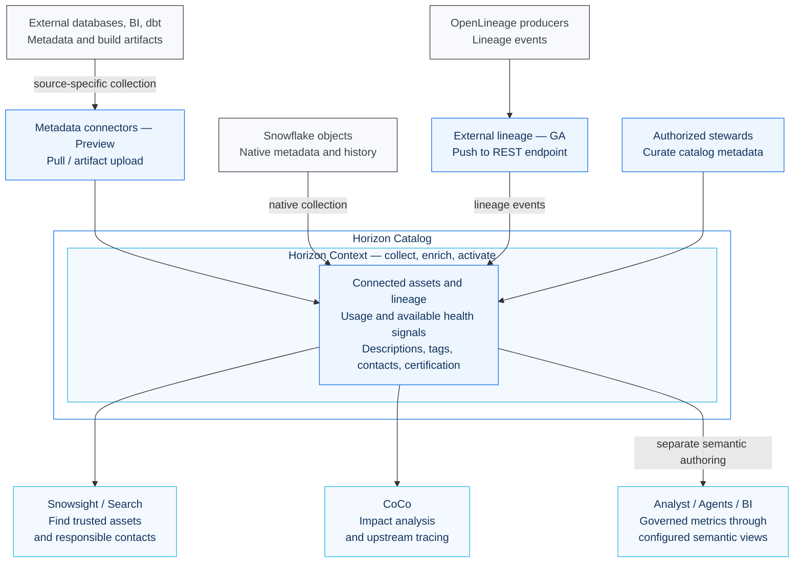

# Horizon Context + Cortex Sense: The Context Stack Explained

[Horizon Context](https://docs.snowflake.com/en/user-guide/snowflake-horizon/horizon-context) collects, enriches, and activates metadata across Snowflake and external systems. Its October 12, 2026 preview adds 18 metadata connectors, external metadata curation, and column description propagation. This guide separates those documented capabilities from the announced [Cortex Sense](https://www.snowflake.com/en/blog/enterprise-ai-agents-grounded-context/) runtime layer, and explains why metadata visibility, data access, and agent tool configuration are different controls.

**Audience:** Data engineers, data stewards, and platform owners connecting their data estate and evaluating context for AI applications.
**Created:** 2026-07-09 | **Last updated:** 2026-10-15 | **Expires:** 2026-11-28 | **Status:** ACTIVE

**Last verified:** 2026-10-15 (operational architecture and collection paths); October release changes: 2026-10-13; full-guide review: 2026-09-29.

Pair-programmed by SE Community + Cortex Code

> **No support provided.** Reference only; validate before production use.

> **Available now:** Horizon Context's October 12 public preview adds external metadata connectors and curation. Semantic Studio and temporary-object lineage preservation are GA. See [Availability Summary](#availability-summary) for supported regions, requirements, and separately announced capabilities.

---

## Start Here

Start with one supported BI or dbt source and a dashboard your team relies on. Check the connector's region, network, and permission requirements, then trace a known dependency and validate its descriptions and metadata visibility before expanding collection.

- **Connect your first source:** [What Can I Do Now?](docs/01-WHAT-CAN-I-DO-NOW.md) links to setup instructions and a validation checklist.
- **Understand the architecture:** [Horizon as an Operational Catalog](#horizon-as-an-operational-catalog) follows metadata from its sources to discovery, impact analysis, troubleshooting, and AI.
- **Plan access controls:** [The Agent Security Boundary](#the-agent-security-boundary) separates metadata visibility, data access, and tool permissions.
- **Check feature availability:** [Availability Summary](#availability-summary) lists release status and requirements.

---

## Vocabulary

| Term | Plain meaning |
| --- | --- |
| **Horizon Catalog** | Snowflake's governance and discovery catalog for native and external assets. Horizon Context is its governed context layer. |
| **Horizon Context** | Collects, enriches, and activates metadata, including external BI tools, databases, and pipelines. Preview release dated October 12, 2026. |
| **Metadata Connector** | A built-in integration that ingests schemas, query logs, and dashboard definitions from an external system into Horizon Catalog. |
| **Semantic View** | A Snowflake object defining business metrics, dimensions, and relationships over raw tables. Used by Cortex Analyst to answer natural-language questions. |
| **Cortex Sense** | Announced as a managed runtime context layer, demonstrated with CoCo. Confirm availability and access requirements for your account; see [Availability Summary](#availability-summary). |
| **Cortex Analyst** | The Snowflake service that generates SQL from natural language using a semantic view as its business logic layer. |
| **CoWork** | Snowflake's business-user-facing agent interface, renamed from Snowflake Intelligence at Summit 2026. The `SNOWFLAKE_INTELLIGENCE` database identifier used in DDL is unchanged. |
| **OpenLineage** | An open standard for lineage metadata. Tools such as dbt and Apache Airflow push lineage into Horizon Catalog through Snowflake's external lineage REST endpoint. |
| **Apache Ossie (Incubating)** | The vendor-neutral semantic specification formerly called Open Semantic Interchange (OSI). Accepted into the Apache Incubator under its new name in July 2026. |
| **RBAC** | Role-based access control. Governs which Snowflake roles can access which objects. |
| **GA / Public Preview / Private Preview** | Snowflake maturity labels. Public/open preview permits broad participation but can still have cloud, region, edition, or enablement limits. Private preview requires approved access. Check each feature's requirements separately. |

---

## Why a Context Layer Exists

Your head of sales sees $14.2 million in Q3 revenue. Your CFO sees $12.8 million. Both asked an AI agent the same question this morning. This is metric drift — business logic scattered across a BI model only one team owns, a calculation buried in a dashboard, instructions hardcoded into a prompt. *(Opening scenario from [Snowflake's Horizon Context announcement](https://www.snowflake.com/en/blog/horizon-context-governed-context/).)*

An inventory alone does not resolve competing definitions. Engineers need to trace which models and dashboards depend on a column before changing it. Analysts need to distinguish trusted assets from sandbox copies. Stewards need somewhere to record definitions and responsible contacts. AI tools need those same signals when selecting data and interpreting a question.

Horizon Context makes the catalog useful in those workflows: collect metadata, connect dependencies, add business meaning, and put that context to work.

---

<a id="the-three-layer-stack"></a>

## Horizon as an Operational Catalog

[Horizon Context is built into Horizon Catalog](https://docs.snowflake.com/en/user-guide/snowflake-horizon/horizon-context), not a separate catalog you must copy into before doing useful work. The diagram shows **metadata flow**, not business-data movement or the physical deployment of connector services.



**Read the inputs separately.** Snowflake gathers native metadata from your account. [Metadata connectors](https://docs.snowflake.com/en/user-guide/snowflake-horizon/connectors) collect supported information from explicitly configured external sources; collected fields and refresh behavior depend on the source. [dbt Cloud](https://docs.snowflake.com/en/user-guide/snowflake-horizon/connectors/dbt) supplies build artifacts through scheduled API pulls, while dbt Core artifacts must be regenerated and uploaded manually. Both attach to an existing warehouse source. [OpenLineage](https://docs.snowflake.com/en/user-guide/external-lineage) is a separate producer-push path into the lineage graph, not another connector polling a database.

**The catalog supports decisions, not just searches.** Follow a column downstream before changing it, trace a dashboard upstream when a number looks wrong, or inspect certification and contacts before choosing an asset. Usage helps establish which consumers may be affected; available freshness and quality signals add context. Coverage depends on connected sources and supported lineage paths. A missing edge is not proof that nothing depends on the column.

**Stewardship closes the loop.** When investigation exposes an unclear description or missing contact, an authorized steward can curate that metadata in Horizon Catalog. This is not a source-system writeback or automatic-remediation path. Semantic views are a separately authored or imported business-definition layer; collecting a BI dashboard does not automatically create a governed semantic view. See [Enrich](#enrich) for the supported authoring paths.

**Cortex Sense is a separately qualified extension.** The [announced runtime layer](#cortex-sense-the-runtime-activation-layer) retrieves relevant enriched context for CoCo. It is not required for the catalog workflows above, and its availability and retrieval boundary must be confirmed independently.

**Metadata visibility is not data access.** Reading the catalog does not grant permission to query the underlying Snowflake rows or external system. Metadata collection, visibility, editing, and tool execution have separate authorization requirements; see [The Agent Security Boundary](#the-agent-security-boundary).

### Example: Before Changing a Column

Suppose an orders column feeds a dbt model in Snowflake and a Tableau dashboard. With those sources connected and the relevant lineage captured:

1. **Trace impact:** start at the column in the catalog, or ask CoCo which downstream models and dashboards depend on it.
2. **Assess exposure:** inspect the connected consumers, available usage information, and recorded contacts to identify who needs to validate the change.
3. **Make the change through your normal workflow:** update and test the models and dashboards in their own systems. The catalog informs this work; it does not perform it automatically.
4. **Refresh and curate:** allow the configured collection to refresh, re-upload dbt Core artifacts if applicable, then verify the known dependency path and update catalog descriptions or contacts as needed.

The same graph works in reverse during troubleshooting: start at the dashboard and follow its dependencies upstream. These are the [cross-platform impact-analysis and troubleshooting workflows](https://docs.snowflake.com/en/user-guide/snowflake-horizon/horizon-context#example-use-cases) documented for Horizon Context.

---

## Horizon Context in Detail

Horizon Context organizes its work into three phases. Its documentation distinguishes **structural** context (objects and lineage), **operational** context (freshness and quality), **semantic** context (business definitions), and **behavioral** context (usage and popularity).

### Collect

The [October 12 preview](https://docs.snowflake.com/en/release-notes/2026/other/2026-10-12-horizon-context-preview) introduced **18 metadata connectors in open preview**, covering BI tools, databases, and dbt. Use the maintained [connector catalog](https://docs.snowflake.com/en/user-guide/snowflake-horizon/connectors) for the current list and source-specific setup. These are metadata connections, not business-data replication pipelines, and nothing connects automatically.

**Check eligibility before designing around a connector.** The release lists AWS/Azure commercial regions, not every Snowflake region. Source permissions and refresh behavior vary by connector. Read the [security requirements](https://docs.snowflake.com/en/user-guide/snowflake-horizon/connectors/security) before onboarding: they do not guarantee stable egress IPs or uniform TLS enforcement across source types. Do not broaden database network access just to complete setup.

Separately, **[external lineage](https://docs.snowflake.com/en/user-guide/external-lineage)** — the OpenLineage ingestion path — reached **GA on September 3, 2026**. Use it when your producer already emits lineage events; use metadata connectors when you need source-specific catalog collection. Check the external-lineage documentation for edition requirements, authorization, supported events, and capacity limits.

**[Apache Ossie (Incubating)](https://www.snowflake.com/en/blog/apache-ossie-open-semantic-interchange-incubator/)** — formerly Open Semantic Interchange (OSI) — defines a vendor-neutral format for exchanging semantic metadata across catalog vendors, BI tools, query engines, and AI agents. The June 2026 Horizon Context announcement cited 54 participating vendors; the July Apache update describes the coalition as more than 50 organizations.

### Enrich

Once collected, raw metadata is enriched into usable business context:

- **End-to-end column-level lineage** — stitched from Snowflake query logs, external system logs, BI definitions, and OpenLineage feeds. Column-level mappings arrive through the OpenLineage `columnLineage` facet and are resolved best-effort: an unresolvable column is skipped rather than failing the event.
- **Popularity signals** — query and access frequency used to distinguish authoritative assets from experimental ones.
- **Certification status** — the explicit human signal that an asset is trusted. Note the tag moved: `SNOWFLAKE.TAGS.CERTIFICATION_STATUS` arrived in public preview on August 31, 2026 and is now the recommended tag. `SNOWFLAKE.CORE.CERTIFICATION_STATUS` is **still supported and has not been deprecated**, but Snowflake documents it as planned for deprecation in a future release. New work should use the `SNOWFLAKE.TAGS` tag, whose allowed values are fixed by Snowflake and cannot be modified by account administrators — which is what lets governance and AI workflows interpret it consistently.
- **AI-generated documentation** — table and column descriptions generated from metadata and optionally sample data.
- **Metadata curation without ownership** — use [`APPLY COMMENT`](https://docs.snowflake.com/en/user-guide/snowflake-horizon/connectors/access-control#apply-comment) for comment-only stewardship rather than granting broad modification rights. Within Horizon Catalog, stewards can edit descriptions and apply tags and contacts to external assets such as Power BI and Tableau dashboards. Follow the [documented permissions](https://docs.snowflake.com/en/user-guide/snowflake-horizon/connectors/access-control) for each operation.
- **Column comment propagation (open preview)** — [opt-in propagation](https://docs.snowflake.com/en/user-guide/comment-propagation) reduces repeated descriptions where values pass through unchanged. It does not replace documentation for transformed metrics or overwrite manual downstream comments. Check supported objects, lineage eligibility, and disable behavior before enabling it.
- **Semantic Views** — the governed business definition layer. [Semantic View Autopilot](https://docs.snowflake.com/en/user-guide/views-semantic/autopilot) can generate a view from selected tables plus example SQL, and can ingest Tableau `.twb`, `.twbx`, `.tds`, and `.tdsx` files. [Power BI ingestion became GA on August 18, 2026](https://docs.snowflake.com/en/release-notes/2026/other/2026-08-18-semantic-views-power-bi-ingestion-ga) and supports `.pbit` and `.pbix`; report-level measures and time-intelligence functions such as `PREVIOUSMONTH` and `SAMEPERIODLASTYEAR` are not yet fully supported.

### Lineage coverage and limits

[Temporary-object lineage preservation](https://docs.snowflake.com/en/user-guide/lineage-temporary-objects) is **GA since September 21, 2026**. It preserves supported paths through intermediate temporary objects after cleanup; temporary and transient are not interchangeable.

The [October 6 update](https://docs.snowflake.com/en/release-notes/2026/other/2026-10-06-lineage-integrations-monitors-search) expands lineage for storage integrations, external tables, model monitors, and stage-created Cortex Search services. Coverage is not retroactive and depends on the creation path. Check the linked limitations before interpreting a missing edge as proof of no dependency; do not recreate production objects merely to populate the graph.

### Activate

Enriched context is only valuable if it reaches the AI at the right moment:

- **Universal Search** — CoCo's context retrieval uses hybrid keyword plus semantic search, filtered by access control policies, ranked by popularity.
- **Automatic semantic view discovery** — when asked a data question, CoCo searches for and uses relevant semantic views, falling back to direct table access if none exist. That fallback is the behavior to understand before assuming a semantic view constrains what an agent will consult.
- **Semantic View interoperability** — semantic views exposed via MCP allow Claude, Cursor, and other MCP clients to query Snowflake data with governed business logic. Power BI, Excel, ThoughtSpot, and Looker integrations were named in the Summit announcement; confirm support for your intended integration before depending on it.

---

## Cortex Sense: The Runtime Activation Layer

Horizon Context builds the enriched catalog. Cortex Sense is the managed layer Snowflake demonstrated activating that context for CoCo queries.

Cortex Sense is a separately announced capability, demonstrated with **CoCo**. Before adopting it, confirm availability, supported clients, and metadata access controls with your Snowflake account team. The Horizon Context public preview does not confirm Sense availability for your account or integration with other agents.

### Why It Exists

Snowflake reported that [fewer than 5% of its 9,685 internal tables](https://www.snowflake.com/en/blog/enterprise-ai-agents-grounded-context/) were covered by semantic views, even with Semantic View Autopilot. Cortex Sense is designed to help supply context for questions beyond that curated coverage.

For your own estate, identify which important business questions already have semantic-view coverage and which still depend on undocumented tables or scattered definitions.

### How It Works

The [announced Sense design](https://www.snowflake.com/en/blog/enterprise-ai-agents-grounded-context/) builds a working model of the data estate from signals your organization already produces:

- Query history from Snowflake and connected external systems
- Object metadata and table structures
- BI dashboard definitions (Power BI, Tableau) via Horizon Context connectors
- Semantic views — treated as the authoritative, highest-ranked signal

Rather than injecting the full catalog into every prompt, Sense retrieves only the context relevant to the specific query, ranking candidates by relevance, authority, popularity, and freshness.

### Accuracy and Cost (Snowflake Internal Benchmark)

Snowflake published the following from [internal testing on their own product analytics data in June 2026](https://www.snowflake.com/en/blog/enterprise-ai-agents-grounded-context/). These results measure Snowflake's workload, not expected accuracy or cost for yours.

| Setup | Accuracy | Estimated cost per query |
| --- | --- | --- |
| Frontier coding agent with direct SQL access (no context layer) | ~24% | ~$1.76 |
| CoCo with Cortex Sense | ~86% | ~$0.59 |

Snowflake attributes the lower per-query cost to reducing repeated metadata discovery. The blog also describes an upfront indexing cost that lower per-query costs can offset over time. Evaluate accuracy and total consumption on your own workload, including indexing.

### Self-Correcting Evaluation Loop

The announced design includes an evaluation loop to identify errors and conflicting definitions:

- When evaluation queries fail, Sense reflects on why and attempts to update its own model.
- When it detects conflicting definitions (for example, multiple teams computing "daily active users" differently), it surfaces the conflict to an admin to resolve in natural language.
- Evaluation inputs come from three sources: your gold-standard benchmark queries, end-user feedback, and Sense's own suggestions where coverage is thin.

### Announced Access Model

From [Snowflake's blog (June 30, 2026)](https://www.snowflake.com/en/blog/enterprise-ai-agents-grounded-context/):

> *"Cortex Sense will only ingest metadata and usage patterns, not your actual data rows. But like all other Snowflake objects, access will be scoped by role through Snowflake's existing governance. We're starting our private preview soon by allowing users to specify a single role that will get access to all of Cortex Sense, and will plan to expand to per-role contexts in the future, so your marketing team and finance team will get access to different contexts."*

**Announced initial model:** one designated role receives access to all Cortex Sense context, with per-role differentiation planned as future work. This is a forward-looking statement from a blog post, not documented current behavior. Verify both access and actual retrieval behavior with the account team.

---

## The Agent Security Boundary

Data access, metadata visibility, and tool permissions are separate controls. Review all three when adding context to an existing AI application.

### Role Permissions and Configured Tools

An agent configured with a semantic view has two distinct checkpoints:

```text
Layer 1: RBAC
  The calling role's access scope.
  Controls what data the user (and agents acting as the user)
  can physically query.

    ↓

Layer 2: Semantic view as explicit tool configuration
  The agent is configured to use only sv_regional_sales.
  Even though the analyst role has SELECT on finance.*,
  the agent's declared Analyst tool is the semantic view.
```

You can audit the role's data privileges and the agent's declared tools independently. Tool configuration narrows the resources an agent is designed to use. It is not a replacement for least-privilege RBAC.

### Execution and Tool Controls

Adding context does not replace execution-time access controls:

- Direct SQL is constrained by its execution role and applicable policies. Audit delegated tools separately: an owner-rights procedure can act with its owner's privileges, and a search service is a separately authorized resource. The announced Sense design ingests metadata and usage patterns, not data rows; that statement does not define every connector or tool's execution boundary.
- Semantic views are still supported as explicit tool configurations for Cortex Agents.
- [Horizon Context documentation](https://docs.snowflake.com/en/user-guide/snowflake-horizon/horizon-context) states that Snowflake enforces access, masking, and row-access policies at the query engine. It explicitly treats metadata visibility separately. Tool execution identities and permission paths still need separate review.

Cortex Agents provide four relevant controls:

- **Execution identity:** Cortex Agents determine permissions from the querying user's **default role**, not the role currently active in the session.
- **Configured tools:** the default role needs the privileges required to invoke each tool. Explicit Analyst and Search resources narrow those tools, but tool configuration is not a universal execution ceiling. SQL, code, and custom tools have their own execution contracts; stored procedures can use owner's or caller's rights. Audit both invocation access and delegated authority.
- **Inaccessible tools:** `orchestration.tool_not_accessible: accept` continues with accessible tools and reports inaccessible named, checked resources. `reject` gates the documented checked set, not every tool or underlying dependency. Read [which tools are checked](https://docs.snowflake.com/en/user-guide/snowflake-cortex/cortex-agents-inaccessible-tool-handling) and test execution-time failures separately.
- **Agent privilege ceiling:** [Restricted Session Scope](https://docs.snowflake.com/en/user-guide/restricted-session-scope) can limit what agent-active sessions may do, intersecting with RBAC. It does not establish or document Cortex Sense's context-retrieval boundary.

### Metadata Visibility Is a Separate Control

The [Horizon Context access-control documentation](https://docs.snowflake.com/en/user-guide/snowflake-horizon/connectors/access-control) now explicitly separates metadata from data access. A role can see names, descriptions, and lineage without permission to query the underlying rows.

- **Native metadata:** parent `USAGE` plus object privileges such as `REFERENCES` can expose metadata without `SELECT`.
- **Connector metadata:** connector `USAGE`, with the documented parent and lineage privileges, permits visibility into collected metadata. It does not reveal stored credentials or grant external-system access.
- **Curation:** `APPLY COMMENT` permits comment-only changes, not arbitrary DDL or data changes. Tag editing is a separate permission.

Therefore, **removing SELECT does not establish that an object's existence or description is hidden**. Inventory metadata grants independently, including connector access. Separating databases alone is insufficient if roles retain metadata visibility through other authorized paths.

### The Open Question

> *Does Cortex Sense context retrieval respect an agent's configured tool scope (for example, limited to `sv_regional_sales`), or does it operate at the calling user's full RBAC role scope?*

**As of 2026-10-15, tool-scoped Sense retrieval remains unconfirmed.** The [Sense announcement](https://www.snowflake.com/en/blog/enterprise-ai-agents-grounded-context/) describes role-scoped access, not filtering by an agent's declared tools. Horizon Context's metadata grants alone do not answer this question.

Why this matters in practice: if a use case requires that an agent not merely be unable to *query* certain data but be unaware of its *existence* — deal rooms, pre-announcement financials, segregated client books — then role-scoped retrieval and tool-scoped retrieval are materially different security postures. Metadata leakage (a table name, a column name, a metric definition) can be the disclosure.

Before using Sense with sensitive metadata, confirm the retrieval boundary with your Snowflake account team for your account and release. Validate it with representative roles and queries. Until that boundary is established, keep sensitive metadata out of the evaluation; an agent's tool list alone is not evidence that the metadata is hidden.

### The Related Agent Identity Risk

Separately from Sense, [Snowflake's Cortex Agent access-control documentation](https://docs.snowflake.com/en/user-guide/snowflake-cortex/cortex-agents-setup) defines the execution identity, and [P0 Security's April 2026 research](https://p0.dev/blog/when-your-snowflake-ai-agent-can-query-everything-you-can-query/) discusses its security implications:

> Cortex Agents determine permissions from the **querying user's default role**, not the role currently active in the session. That default role also needs privileges on the agent's configured tools and underlying resources.

This is not a new risk introduced by Horizon Context or Cortex Sense. It is a pre-existing characteristic of how Cortex Agents execute, and it predates both. The practical control is a purpose-built, minimal-privilege default role, optionally paired with Restricted Session Scope for agent-active sessions. A user whose default role is broad does not get narrower because an agent was configured narrowly.

### Practical Guidance

| Use case | Recommended approach |
| --- | --- |
| Discovery and analytics | Use documented catalog and semantic-view capabilities now; evaluate Sense separately after confirming the supported client and retrieval contract. |
| Regulated workload with an auditability requirement | Keep explicit semantic view tools; use `reject` for mandatory named, checked tools and test remaining tools and dependencies separately. Do not treat Sense retrieval as a scope control. |
| Workload where metadata itself is sensitive | Audit metadata grants separately from data grants, including connector `USAGE` and native metadata visibility. Neither removing SELECT nor narrowing tool configuration proves object existence is hidden. |
| Any agent deployment | Use a purpose-built, minimal-privilege default role; consider Restricted Session Scope as an additional ceiling. |
| MCP-connected agents | Inventory every downstream system that can receive agent output. The data path extends beyond the warehouse. |

---

## Availability Summary

Baseline snapshot: **2026-09-29**; October feature updates: **2026-10-13**. Follow the linked documentation for current availability and requirements.

| Feature | Status | Requirements / details |
| --- | --- | --- |
| Horizon Catalog (base) | **GA** | [Catalog discovery and governance](https://docs.snowflake.com/en/user-guide/snowflake-horizon) |
| Semantic Views | **GA** | Querying semantic views reached GA in the 9.25 release (August 2025) |
| Semantic View Autopilot | **GA** | Its Semantic Studio entry point is also GA as of September 30, 2026 |
| Power BI ingestion for Semantic View Autopilot | **GA (August 18, 2026)** | Supports `.pbit` and `.pbix`; report-level measures and time-intelligence functions remain limited |
| External lineage / OpenLineage ingestion | **GA (September 3, 2026)** | Follow the [current requirements and limits](https://docs.snowflake.com/en/user-guide/external-lineage) |
| Semantic Studio (semantic view authoring environment) | **GA (September 30, 2026)** | [Release details](https://docs.snowflake.com/en/release-notes/2026/other/2026-09-30-semantic-studio-ga) |
| Horizon Context / metadata connectors | **Preview / open preview (October 12, 2026)** | 18 documented sources; AWS/Azure commercial regions, excluding government and China. See source-specific setup and security requirements |
| Metadata access control / `APPLY COMMENT` | **Open preview** | Separate metadata visibility and comment-only curation privileges |
| Column comment propagation | **Open preview** | [opt-in behavior and limitations](https://docs.snowflake.com/en/user-guide/comment-propagation) |
| Temporary-object lineage preservation | **GA (September 21, 2026)** | [supported paths and limitations](https://docs.snowflake.com/en/user-guide/lineage-temporary-objects) |
| Advanced Semantics (LOD calculations, composable definitions) | **Partially documented — status unconfirmed** | Confirm authoring support for LOD metrics and composable definitions before use. Tableau ingestion does not import Tableau LOD calculations |
| Cortex Sense | **Availability unconfirmed** | Confirm account availability, supported clients, and metadata access controls separately from Horizon Context |
| Cortex Sense — per-role context differentiation | **Announced as future work — unconfirmed** | Confirm support for separate role-specific contexts before planning a deployment |
| Power BI semantic view interop | **Unconfirmed — verify with your account team** | Named in the Summit announcement; confirm support for your intended integration |
| Excel semantic view interop | **Unconfirmed — verify with your account team** | Named in the Summit announcement; confirm support for your intended integration |
| Cortex Agents | **GA (November 4, 2025)** | Asynchronous API reached GA August 30, 2026 |
| Cortex Search | **GA (October 4, 2024)** | [Search service documentation](https://docs.snowflake.com/en/user-guide/snowflake-cortex/cortex-search/cortex-search-overview) |
| `SNOWFLAKE.TAGS.CERTIFICATION_STATUS` | **Public Preview (August 31, 2026)** | Recommended replacement; allowed values fixed by Snowflake and not modifiable |
| `SNOWFLAKE.CORE.CERTIFICATION_STATUS` | **Still supported; not yet deprecated** | Documented as planned for deprecation in a future release. Migrate new work to the `SNOWFLAKE.TAGS` tag |

---

## Related Guides

- [Snowflake Horizon Catalog](https://docs.snowflake.com/en/user-guide/snowflake-horizon)
- [Cortex Agents access control and authentication](https://docs.snowflake.com/en/user-guide/snowflake-cortex/cortex-agents-setup)
- [Restricted Session Scope for agents](https://docs.snowflake.com/en/user-guide/restricted-session-scope)
- [Best practices for modeling semantic views](https://docs.snowflake.com/en/user-guide/views-semantic/best-practices)
- [External lineage](https://docs.snowflake.com/en/user-guide/external-lineage)
- [Snowflake-provided tags](https://docs.snowflake.com/en/user-guide/object-tagging/snowflake-provided-tags)

---

## External References

- [Horizon Context — Preview release (October 12, 2026)](https://docs.snowflake.com/en/release-notes/2026/other/2026-10-12-horizon-context-preview)
- [Horizon Context documentation](https://docs.snowflake.com/en/user-guide/snowflake-horizon/horizon-context)
- [Horizon Catalog connectors](https://docs.snowflake.com/en/user-guide/snowflake-horizon/connectors)
- [Metadata access control](https://docs.snowflake.com/en/user-guide/snowflake-horizon/connectors/access-control)
- [Connector security and data protection](https://docs.snowflake.com/en/user-guide/snowflake-horizon/connectors/security)
- [Column comment propagation](https://docs.snowflake.com/en/user-guide/comment-propagation)
- [Temporary-object lineage preservation](https://docs.snowflake.com/en/user-guide/lineage-temporary-objects)
- [Expanded lineage relationships (October 6, 2026)](https://docs.snowflake.com/en/release-notes/2026/other/2026-10-06-lineage-integrations-monitors-search)

- [Horizon Context blog — Snowflake (June 2, 2026)](https://www.snowflake.com/en/blog/horizon-context-governed-context/)
- [Cortex Sense blog — Snowflake (June 30, 2026)](https://www.snowflake.com/en/blog/enterprise-ai-agents-grounded-context/)
- [Snowflake Horizon Catalog](https://docs.snowflake.com/en/user-guide/snowflake-horizon)
- [Cortex Agents documentation](https://docs.snowflake.com/en/user-guide/snowflake-cortex/cortex-agents)
- [Cortex Agents access control and authentication](https://docs.snowflake.com/en/user-guide/snowflake-cortex/cortex-agents-setup)
- [Cortex Agents inaccessible tool handling](https://docs.snowflake.com/en/user-guide/snowflake-cortex/cortex-agents-inaccessible-tool-handling)
- [Restricted Session Scope for agents](https://docs.snowflake.com/en/user-guide/restricted-session-scope)
- [Semantic View Autopilot](https://docs.snowflake.com/en/user-guide/views-semantic/autopilot)
- [Semantic Studio](https://docs.snowflake.com/en/user-guide/views-semantic/semantic-studio)
- [Semantic Studio — GA release note (September 30, 2026)](https://docs.snowflake.com/en/release-notes/2026/other/2026-09-30-semantic-studio-ga)
- [Power BI ingestion for Semantic View Autopilot — GA release note (August 18, 2026)](https://docs.snowflake.com/en/release-notes/2026/other/2026-08-18-semantic-views-power-bi-ingestion-ga)
- [External lineage](https://docs.snowflake.com/en/user-guide/external-lineage)
- [External lineage — GA release note (September 3, 2026)](https://docs.snowflake.com/en/release-notes/2026/other/2026-09-03-external-lineage-ga)
- [Snowflake-provided tags](https://docs.snowflake.com/en/user-guide/object-tagging/snowflake-provided-tags)
- [Snowflake-provided tags — Public Preview release note (August 31, 2026)](https://docs.snowflake.com/en/release-notes/2026/other/2026-08-31-snowflake-provided-tags-preview)
- [Apache Ossie (Incubating), formerly Open Semantic Interchange](https://www.snowflake.com/en/blog/apache-ossie-open-semantic-interchange-incubator/)
- [P0 Security: Snowflake Cortex agents and privilege inheritance (April 2026)](https://p0.dev/blog/when-your-snowflake-ai-agent-can-query-everything-you-can-query/) — external security research, not a Snowflake statement
