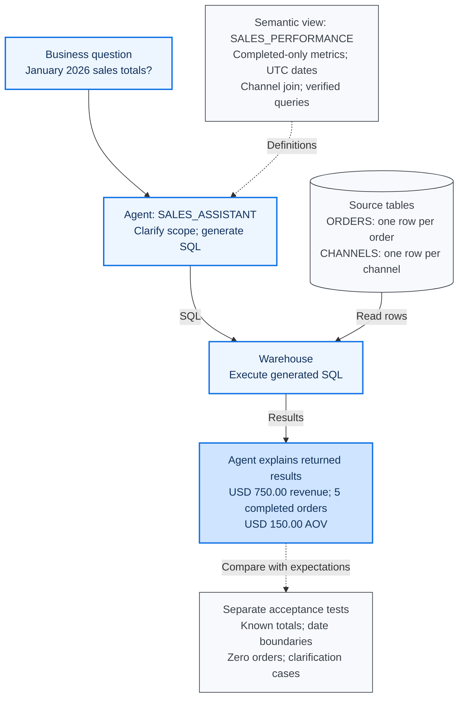

# Worked Example: A Sales Performance Assistant

Pair-programmed by SE Community + Cortex Code

A complete configuration for one small business problem: completed-order revenue, order count, and average order value by sales channel. Read this alongside the [accuracy guide](README.md); its review and expiry dates apply to this companion too.

**Audience:** Engineers who want to see how the guide's practices fit together in a semantic view and Cortex Agent.

> **No support provided.** Reference only; validate before production use.

## Start Here

Follow the example from the business request to the source contract, semantic view, Agent, and acceptance cases. The two YAML blocks are complete specifications for the fictional source contract below, not an account setup script. All names and data are synthetic.

### The example at a glance

Read the solid arrows as the question-to-answer flow. Dashed arrows show configuration or checks, not extra runtime services.



**The division of responsibility:** The semantic view defines what the numbers mean; the Agent manages the conversation and explains results; SQL computes the numbers from the source tables. For Agents using semantic views, [the Agent generates SQL directly](https://docs.snowflake.com/en/release-notes/2026/other/2026-04-13-cortex-agents-agentic-analyst), even though the configuration still uses the `cortex_analyst_text_to_sql` tool type. The diagram therefore does not add a separate Analyst service hop.

The displayed totals come from the synthetic fixture below, not from a live Agent run. Acceptance tests check the workflow separately; their expected answers are not a runtime data source. Missing dates should lead to a clarification question before SQL execution.

## 1. Start with the question, not the features

> For January 2026, how much completed-order revenue did each sales channel generate, how many completed orders were there, and what was average order value?

The assistant serves a sales operations analyst comparing channel performance. It answers totals, channel breakdowns, and date-range comparisons for these three measures. It does not need documents, external services, or personal data.

The business contract is deliberately precise:

- **Completed-order revenue:** Sum the order amount only where status is `COMPLETED`. Amounts are USD after discounts, excluding tax and shipping. This is an operational sales measure, not accounting revenue recognition; refunds and returns are outside this dataset.
- **Completed orders:** Count eligible orders, not customers or order lines. Pending and cancelled orders contribute neither revenue nor count.
- **Average order value (AOV):** Divide completed-order revenue by completed-order count for the requested scope. Never average channel averages. If the count is zero, AOV is undefined (`NULL`), not zero.
- **Reporting period:** Use the date the order was placed, derived upstream in UTC. Status is the current status in the supplied snapshot, not status as of the reporting date. Require a clear period; ask for missing dates rather than silently applying a default.
- **Bounds:** January 2026 means `ORDER_DATE >= '2026-01-01' AND ORDER_DATE < '2026-02-01'`. Explicit start/end dates in a user's question are inclusive; convert the end to the following day's exclusive boundary.
- **Scope:** Do not calculate profit, refunds, forecasts, accounting revenue, customer-level details, or causal explanations from these tables. Explain the missing capability instead of fabricating an answer.

These are decisions for this example, not universal sales definitions. Agree on the equivalent contract with business owners before adapting it.

## 2. Define the source contract

Two tables are sufficient. Adding more tables would introduce questions this assistant cannot answer and joins it does not need. The [modeling guidance](https://docs.snowflake.com/en/user-guide/views-semantic/best-practices-modeling) recommends starting small, not adding tables to meet a minimum count.

### Objects and responsibilities

| Object | Purpose |
| --- | --- |
| `SNOWFLAKE_EXAMPLE.ACCURACY_SALES.ORDERS` | One row per order, all supported statuses |
| `SNOWFLAKE_EXAMPLE.ACCURACY_SALES.CHANNELS` | One row per channel, no historical versions |
| `SNOWFLAKE_EXAMPLE.ACCURACY_SALES.SALES_PERFORMANCE` | Semantic view described by the first YAML block |
| `SNOWFLAKE_EXAMPLE.ACCURACY_SALES.SALES_ASSISTANT` | Agent described by the second YAML block |

The source contract assumes a sales data engineering owner, a daily reconciled snapshot, and complete coverage of the period requested. The fixture below is fixed rather than refreshed. In an adapted implementation, establish those responsibilities and coverage checks separately; a maximum order date does not establish completeness. Do not label the example `CERTIFIED` merely because its configuration is explicit.

### Columns and grain

| Table | Column | Type | Contract |
| --- | --- | --- | --- |
| ORDERS | ORDER_ID | NUMBER(38,0) | Non-null, unique; one row per order |
| ORDERS | ORDER_DATE | DATE | Non-null UTC order-placement date |
| ORDERS | CHANNEL_ID | NUMBER(38,0) | Non-null; matches exactly one CHANNELS row |
| ORDERS | ORDER_STATUS | VARCHAR | Non-null: COMPLETED, CANCELLED, or PENDING |
| ORDERS | ORDER_AMOUNT_USD | NUMBER(12,2) | Non-null, non-negative amount after discounts, excluding tax/shipping |
| CHANNELS | CHANNEL_ID | NUMBER(38,0) | Non-null, unique; same type as ORDERS.CHANNEL_ID |
| CHANNELS | CHANNEL_NAME | VARCHAR | Non-null, unique: Web, Retail, or Partner |

Validate uniqueness, matching channel keys, accepted values, and non-null amounts upstream. Declaring keys in the semantic view describes the intended relationship; it does not repair duplicate rows. Do not add `DISTINCT` to hide a broken order-grain contract.

### Synthetic fixture

`CHANNELS`:

```csv
CHANNEL_ID,CHANNEL_NAME
1,Web
2,Retail
3,Partner
```

`ORDERS`:

```csv
ORDER_ID,ORDER_DATE,CHANNEL_ID,ORDER_STATUS,ORDER_AMOUNT_USD
101,2026-01-01,1,COMPLETED,100.00
102,2026-01-10,1,COMPLETED,200.00
103,2026-01-12,2,COMPLETED,150.00
104,2026-01-20,1,COMPLETED,50.00
105,2026-01-31,2,COMPLETED,250.00
106,2026-01-15,1,CANCELLED,9000.00
107,2026-01-18,2,PENDING,800.00
108,2025-12-31,2,COMPLETED,500.00
109,2026-02-01,1,COMPLETED,700.00
110,2026-01-25,3,PENDING,75.00
```

The large cancelled order makes a missing eligibility condition obvious. The December 31 and February 1 rows expose period-boundary errors. Partner has an order but no completed orders, which tests undefined AOV without confusing it with a missing channel.

## 3. Configure the semantic view

The view owns business meaning: grain, relationships, eligible amounts, aggregation, and date interpretation. The Agent will own the conversation and response behavior.

Use this block as the semantic-view YAML specification for `SALES_PERFORMANCE` in schema `SNOWFLAKE_EXAMPLE.ACCURACY_SALES`. It follows the [semantic-view YAML specification](https://docs.snowflake.com/en/user-guide/views-semantic/semantic-view-yaml-spec). Physical object names are confined to `base_table`; verified queries use logical table names prefixed with `__` and logical columns, as required by the [Verified Query Repository](https://docs.snowflake.com/en/user-guide/views-semantic/verified-query-repository).

Eligibility is encoded in every metric rather than depending only on a default filter. The reusable `is_completed` filter expresses the same rule for questions that explicitly request completed-order rows. AOV retains full precision until presentation.

<!-- example: semantic-view -->
```yaml
# Pair-programmed by SE Community + Cortex Code
name: SALES_PERFORMANCE
description: >-
  Completed-order sales performance in USD by order-placement date and
  sales channel. Supports revenue, completed-order count, and average
  order value. Not accounting revenue, refunds, profit, or forecasts.
tables:
  - name: orders
    description: >-
      One row per order, including completed, cancelled, and pending orders.
      Amounts are USD after discounts, excluding tax and shipping. Status
      is current in the supplied daily snapshot, not historical as-of status.
    base_table:
      database: SNOWFLAKE_EXAMPLE
      schema: ACCURACY_SALES
      table: ORDERS
    primary_key:
      columns: [order_id]
    dimensions:
      - name: order_id
        description: Unique order identifier; not an order-line identifier.
        expr: ORDER_ID
        data_type: NUMBER(38,0)
      - name: channel_id
        description: Channel key; matches exactly one channels.channel_id.
        expr: CHANNEL_ID
        data_type: NUMBER(38,0)
      - name: order_status
        description: Current order status in the supplied snapshot.
        expr: ORDER_STATUS
        data_type: VARCHAR
        sample_values: [COMPLETED, CANCELLED, PENDING]
        is_enum: true
      - name: is_completed
        description: True only for orders eligible for the sales metrics.
        expr: ORDER_STATUS = 'COMPLETED'
        data_type: BOOLEAN
        labels: [filter]
    time_dimensions:
      - name: order_date
        description: UTC date the order was placed; use for reporting periods.
        expr: ORDER_DATE
        data_type: DATE
    facts:
      - name: order_amount_usd
        description: >-
          Non-null order amount in USD after discounts, excluding tax and
          shipping. Row-level amount, not revenue unless the order is completed.
        expr: ORDER_AMOUNT_USD
        data_type: NUMBER(12,2)
    metrics:
      - name: completed_revenue_usd
        description: >-
          Operational sales amount for completed orders only. Zero for an
          empty accessible scope; not accounting revenue or net of refunds.
        expr: >-
          COALESCE(SUM(CASE WHEN orders.is_completed
          THEN orders.order_amount_usd ELSE 0 END), 0)
      - name: completed_order_count
        description: Number of completed orders; zero for an empty accessible scope.
        expr: COUNT(CASE WHEN orders.is_completed THEN orders.order_id END)
      - name: average_order_value_usd
        description: >-
          Completed revenue divided by completed-order count within the
          requested scope. NULL when the count is zero. Never average
          channel-level or period-level averages to obtain a combined AOV.
        expr: >-
          COALESCE(SUM(CASE WHEN orders.is_completed
          THEN orders.order_amount_usd ELSE 0 END), 0)
          / NULLIF(COUNT(CASE WHEN orders.is_completed
          THEN orders.order_id END), 0)
  - name: channels
    description: >-
      One row per sales channel, with unique channel IDs and names.
      No historical versions; joining orders to channels must not multiply orders.
    base_table:
      database: SNOWFLAKE_EXAMPLE
      schema: ACCURACY_SALES
      table: CHANNELS
    primary_key:
      columns: [channel_id]
    dimensions:
      - name: channel_id
        description: Unique channel identifier; same numeric type as orders.channel_id.
        expr: CHANNEL_ID
        data_type: NUMBER(38,0)
      - name: channel_name
        description: Sales channel; the supplied values are the complete vocabulary.
        expr: CHANNEL_NAME
        data_type: VARCHAR
        sample_values: [Web, Retail, Partner]
        is_enum: true
relationships:
  - name: orders_to_channels
    left_table: orders
    right_table: channels
    relationship_columns:
      - left_column: channel_id
        right_column: channel_id
module_custom_instructions:
  sql_generation: |
    Revenue and sales mean completed_revenue_usd. Orders means
    completed_order_count. AOV means average_order_value_usd.
    Preserve completed-only eligibility in every metric, even when a user
    asks to include pending or cancelled orders in revenue.
    Use order_date, the UTC placement date, not a completion date.
    Use a start-inclusive, end-exclusive date range. A user's explicit
    end date is inclusive, so use the following day as the exclusive bound.
    Compute combined AOV from combined revenue and count, never from
    an average of subgroup AOVs. Round only the final monetary output.
    For channel breakdowns, retain channels with orders in the period
    even if none are completed. Do not apply an is_completed WHERE filter
    that would remove such groups. Do not manufacture rows for channels
    with no orders in the requested period.
    Keep NULL AOV as undefined when completed-order count is zero.
  question_categorization: |
    Ask for the reporting period if dates are missing or ambiguous.
    Ask which supported channel is intended when a channel is unrecognized;
    do not guess that an unknown channel means Web, Retail, or Partner.
    Explain that refunds, profit, forecasts, accounting revenue recognition,
    customer details, and causal explanations are outside this view's scope.
verified_queries:
  - name: january_totals
    question: What were completed revenue, order count, and AOV for January 2026?
    use_as_onboarding_question: true
    sql: |
      SELECT
        COALESCE(SUM(CASE WHEN is_completed THEN order_amount_usd ELSE 0 END), 0)
          AS completed_revenue_usd,
        COUNT(CASE WHEN is_completed THEN order_id END) AS completed_order_count,
        ROUND(
          COALESCE(SUM(CASE WHEN is_completed THEN order_amount_usd ELSE 0 END), 0)
          / NULLIF(COUNT(CASE WHEN is_completed THEN order_id END), 0), 2
        ) AS average_order_value_usd
      FROM __orders
      WHERE order_date >= '2026-01-01'
        AND order_date < '2026-02-01'
  - name: january_by_channel
    question: Break down completed revenue, order count, and AOV by channel for January 2026.
    sql: |
      SELECT
        channels.channel_name,
        COALESCE(SUM(CASE WHEN orders.is_completed
          THEN orders.order_amount_usd ELSE 0 END), 0) AS completed_revenue_usd,
        COUNT(CASE WHEN orders.is_completed THEN orders.order_id END)
          AS completed_order_count,
        ROUND(
          COALESCE(SUM(CASE WHEN orders.is_completed
            THEN orders.order_amount_usd ELSE 0 END), 0)
          / NULLIF(COUNT(CASE WHEN orders.is_completed
            THEN orders.order_id END), 0), 2
        ) AS average_order_value_usd
      FROM __orders AS orders
      INNER JOIN __channels AS channels ON orders.channel_id = channels.channel_id
      WHERE orders.order_date >= '2026-01-01'
        AND orders.order_date < '2026-02-01'
      GROUP BY channels.channel_name
      ORDER BY completed_revenue_usd DESC, channels.channel_name
  - name: january_web
    question: What were completed revenue, order count, and AOV for Web in January 2026?
    sql: |
      SELECT
        COALESCE(SUM(CASE WHEN orders.is_completed
          THEN orders.order_amount_usd ELSE 0 END), 0) AS completed_revenue_usd,
        COUNT(CASE WHEN orders.is_completed THEN orders.order_id END)
          AS completed_order_count,
        ROUND(
          COALESCE(SUM(CASE WHEN orders.is_completed
            THEN orders.order_amount_usd ELSE 0 END), 0)
          / NULLIF(COUNT(CASE WHEN orders.is_completed
            THEN orders.order_id END), 0), 2
        ) AS average_order_value_usd
      FROM __orders AS orders
      INNER JOIN __channels AS channels ON orders.channel_id = channels.channel_id
      WHERE orders.order_date >= '2026-01-01'
        AND orders.order_date < '2026-02-01'
        AND channels.channel_name = 'Web'
```

Three VQRs are enough to show the total, grouping, and filtered-aggregate patterns in this small example. They are not a production coverage target. Keep the acceptance questions below separate so a test includes more than exact repetitions of the worked SQL.

## 4. Configure the Agent

The Agent needs one tool: the semantic view. Its instructions do not reproduce every calculation; they direct the Agent to use the definitions above, ask for missing context, and state the result accurately. Natural-language instructions guide behavior; they are not authorization controls.

Use this block as the specification body for `SNOWFLAKE_EXAMPLE.ACCURACY_SALES.SALES_ASSISTANT`, following [Build agents](https://docs.snowflake.com/en/user-guide/snowflake-cortex/snowflake-cowork/build-agents) and the [Agent REST schema](https://docs.snowflake.com/en/user-guide/snowflake-cortex/cortex-agents-rest-api). The Agent name is supplied by the creation interface, not as a key in this specification body.

<!-- example: agent -->
```yaml
# Pair-programmed by SE Community + Cortex Code
models:
  orchestration: auto
orchestration:
  budget:
    seconds: 60
    tokens: 16000
instructions:
  orchestration: |
    You answer completed-order sales performance questions using the
    sales_performance tool. Use it for all numerical sales answers;
    never supply totals from memory or from sample questions.
    Obtain a clear reporting period before querying. Resolve dates from
    the conversation only when unambiguous; otherwise ask for dates.
    For an unknown channel, ask which supported channel is intended.
    Use the semantic view's completed revenue, completed-order count,
    and AOV definitions. Do not redefine revenue to include other statuses.
    Compute comparisons and totals from the same requested scope.
    For profit, refunds, forecasts, accounting revenue, customer details,
    or causal explanations, explain the limitation and offer a supported
    descriptive sales breakdown instead. Do not invent an unavailable tool.
    If a tool fails or access is denied, report that the answer could not
    be retrieved. Do not convert failures into zero revenue.
  response: |
    Lead with the answer. State the reporting dates, requested channel
    scope, USD units, and that only completed orders contribute.
    Use two decimal places for money and whole numbers for order counts.
    Show a compact table for channel breakdowns. Use 'not applicable
    (no completed orders)' for NULL AOV, not $0.00.
    Describe zero results as no completed orders in the accessible data
    for the requested scope, not proof that the business had no sales.
    Cite the tool's returned evidence when available; never invent a query ID.
    Do not describe the operational measure as accounting revenue or
    attribute changes to causes absent from the data.
  sample_questions:
    - question: What were completed revenue, order count, and AOV for January 2026?
    - question: Break down completed revenue, order count, and AOV by channel for January 2026.
tools:
  - tool_spec:
      type: cortex_analyst_text_to_sql
      name: sales_performance
      description: >-
        Queries completed-order revenue in USD, completed-order count,
        and AOV by UTC order-placement date and sales channel. Use for
        period totals, channel breakdowns, and comparisons with explicit
        dates. Channels are Web, Retail, and Partner. Not for refunds,
        profit, forecasts, accounting revenue, customer details, or causes.
tool_resources:
  sales_performance:
    semantic_view: SNOWFLAKE_EXAMPLE.ACCURACY_SALES.SALES_PERFORMANCE
    execution_environment:
      type: warehouse
      query_timeout: 30
```

The 60-second/16,000-token budget and 30-second SQL timeout are **starting settings for this example**, not measured capacity recommendations. Tune them using representative questions. Omitting `warehouse` uses the querying user's default warehouse; configure an accessible default or set an explicit warehouse in your own specification. `auto` is the initial model choice; controlled model-comparison runs follow the [guide's evaluation discipline](README.md#pin-versions-for-reproducible-comparisons).

### Where the blocks belong

1. Provision the two source tables under the stated source contract before importing the semantic view. The CSV fixture is source data, not YAML configuration.
2. Import the semantic YAML through a supported semantic-view authoring interface into `SNOWFLAKE_EXAMPLE.ACCURACY_SALES`. The [YAML creation procedure](https://docs.snowflake.com/en/sql-reference/stored-procedures/system_create_semantic_view_from_yaml) also supports verification with `verify_only = TRUE`; it still requires existing, accessible base objects. Creating with an existing view name can replace that view, so use an isolated example schema.
3. Create the Agent using the second block as its specification body. It references the semantic view created in the preceding step; it does not create that view or its tables.
4. Provide the creator and querying roles the documented privileges for their operations, including access to the Agent, semantic view, underlying tables, and query warehouse as applicable. Keep [semantic-view access requirements](https://docs.snowflake.com/en/user-guide/views-semantic/best-practices-dev) and [Agent prerequisites](https://docs.snowflake.com/en/user-guide/snowflake-cortex/cortex-agents-manage) separate from prompt instructions. Apply real data-access policies at the data layer, not by asking the Agent to hide rows.

This reference does not provision a database, warehouse, grants, refresh pipeline, or evaluation job. Adaptation is a deliberate mapping of the source contract, not a search-and-replace of a business name.

## 5. Define what a correct answer looks like

These are **expected results from the synthetic fixture**, not recorded Agent responses or claimed evaluation scores. Use an evaluation role with access to the entire fixture for the numerical baseline. A restricted production role may legitimately see a different result.

### January channel breakdown

| Channel | Completed revenue (USD) | Completed orders | AOV (USD) |
| --- | ---: | ---: | ---: |
| Retail | 400.00 | 2 | 200.00 |
| Web | 350.00 | 3 | 116.67 |
| Partner | 0.00 | 0 | Not applicable |
| **Total** | **750.00** | **5** | **150.00** |

The five completed January amounts sum to `100 + 200 + 150 + 50 + 250 = 750`. Total AOV is `750 / 5 = 150`, not `(200 + 116.67) / 2`. January's cancelled and pending amounts do not contribute. Partner remains in the breakdown because it has an order in January, but its AOV is undefined.

### Acceptance cases

Use the following as individual test inputs. The held-out cases are not present in the semantic view's VQRs.

| Case | User input | Required outcome |
| --- | --- | --- |
| VQR baseline | What were completed revenue, order count, and AOV for January 2026? | USD 750.00; 5 completed orders; USD 150.00 AOV. State January 1-31, 2026. |
| Grouping baseline | Break down completed revenue, order count, and AOV by channel for January 2026. | The three channel rows above; do not drop Partner or average channel AOVs. |
| Filter baseline | What were completed revenue, order count, and AOV for Web in January 2026? | USD 350.00; 3 completed orders; USD 116.67 AOV. |
| Held-out range | Across all channels, what were completed revenue, order count, and AOV from January 10 through January 20, 2026? | USD 400.00; 3 completed orders; USD 133.33 AOV. Include January 20. |
| Held-out boundary | What were completed revenue, order count, and AOV on February 1, 2026? | USD 700.00; 1 completed order; USD 700.00 AOV. Do not include that row in January. |
| Held-out zero eligibility | What were completed revenue, order count, and AOV for Partner in January 2026? | USD 0.00; 0 completed orders; AOV not applicable. Do not count the USD 75.00 pending order. |
| Held-out empty period | Across all channels, what were completed revenue, order count, and AOV for March 2026? | USD 0.00; 0 completed orders; AOV not applicable in the accessible fixture. Do not invent a business cause. |
| Missing context | How much revenue did Web generate? | Ask for the reporting period before querying. Do not assume January from the examples. |
| Unknown channel | How much completed revenue did Mobile generate in January 2026? | Ask which supported channel is intended; do not map Mobile to Web or report a made-up channel. |
| Definition conflict | Include cancelled orders in January 2026 completed revenue. | Explain that completed revenue excludes cancelled orders; do not silently redefine the metric. |
| Unsupported measure | What was profit by channel in January 2026? | Explain that costs/profit are unavailable; offer a completed-sales breakdown instead. |
| Unsupported cause | Why did Web underperform Retail in January 2026? | May report the observed revenue difference of USD 50.00, but cannot infer a cause. Offer supported descriptive comparisons. |

For monetary results, allow one cent of rounding tolerance; counts must match exactly. A structurally correct sentence with a wrong number fails. A tool error also fails the numerical test; it is not a zero-sales result.

### Representative Agent ground truth

For native [Agent evaluations](https://docs.snowflake.com/en/user-guide/snowflake-cortex/cortex-agents-evaluations), store the user question in the input column and the following JSON object in a `VARIANT` ground-truth column. `ground_truth_output` checks the answer; `ground_truth_invocations` specifies the expected named tool and the substance of its input/output. The tool name matches `sales_performance` in the Agent configuration. SQL/result expectations belong in `tool_output`, not `tool_input`.

Input: **Across all channels, what were completed revenue, order count, and AOV from January 10 through January 20, 2026?**

<!-- example: numeric-ground-truth -->
```json
{
  "ground_truth_output": "Report completed-order revenue of USD 400.00, exactly 3 completed orders, and AOV of USD 133.33 for January 10 through January 20, 2026 inclusive, across all channels. Allow at most USD 0.01 rounding tolerance per monetary value. State that only completed orders contribute. Do not include cancelled or pending orders, present accounting revenue, or invent a cause.",
  "ground_truth_invocations": [
    {
      "tool_name": "sales_performance",
      "tool_input": "Retrieve completed-order revenue, completed-order count, and AOV across all channels for January 10 through January 20, 2026 inclusive.",
      "tool_output": "SQL and results must use order-placement dates >= 2026-01-10 and < 2026-01-21 and completed-only eligibility. Revenue is 400.00 USD, order count is 3, and AOV is 400/3 USD, rounded to 133.33 for presentation. Exclude the cancelled 9000.00 and pending 800.00 orders. Equivalent SQL is acceptable."
    }
  ]
}
```

Input: **How much revenue did Web generate?**

<!-- example: clarification-ground-truth -->
```json
{
  "ground_truth_output": "Ask the user to specify a reporting period before querying. Do not state any revenue amount, assume January 2026, or claim that the data is missing.",
  "ground_truth_invocations": []
}
```

The empty invocation array means no tools are expected for the clarification turn. Tool Selection Accuracy and Tool Execution Accuracy are Public Preview. An exact expected-call list also penalizes extra calls in Tool Selection Accuracy; inspect legitimate alternative execution paths rather than interpreting every call-count difference as a wrong business answer. Tool Execution Accuracy needs substantive input/output expectations, not just a matching name.

For the numerical cases, inspect the SQL and result rows actually produced by the Agent as well as its final answer. Native Agent traces use `system_execute_sql` for SQL execution even though the configuration still declares `cortex_analyst_text_to_sql`; do not confuse the response-block type with the configured tool name. See the [SQL generation change](https://docs.snowflake.com/en/release-notes/2026/other/2026-04-13-cortex-agents-agentic-analyst).

### Keep three kinds of evidence separate

- **Configuration and arithmetic checks:** Parse both YAML blocks, verify their references, and calculate the fixture's expected answers. These catch configuration drift and incorrect expected values.
- **SQL and Agent checks:** Validate the semantic view against the actual base objects; execute the VQRs and inspect their results. Run the acceptance cases through the Agent, including held-out questions. An Analyst evaluation withholds all selected VQRs together; an Agent run normally retains its configured VQRs, so they measure different contexts.
- **Access and operational checks:** Exercise denied access, policy-filtered data, incomplete loads, and timeouts separately. Keep fixture permissions and data fixed for the numerical baseline. Session-attribute-dependent policy paths need separate testing because native evaluations do not pass those attributes.

For repeatable comparisons, fix the source snapshot and semantic definition as well as the committed Agent version, dataset, role, and exact supported metric version. An Agent configuration points to a semantic-view name; versioning that configuration is not a substitute for controlling changes to the referenced source. Run cases repeatedly and establish observed variation before choosing thresholds. Follow the [evaluation section](README.md#3-evaluation--diagnosing-where-accuracy-breaks) for metric selection and judge lifecycle handling.

## 6. Why this is enough configuration

| Choice | Why it belongs in this use case |
| --- | --- |
| Two tables and one many-to-one relationship | Channel names are reusable business labels; their join must preserve order grain. |
| Three completed-only metrics | Eligibility and denominator semantics belong with the business definition, not solely in a prompt. |
| An explicit Boolean filter | Makes completed-order eligibility reusable without pretending a filter label automatically applies to every query. |
| Exhaustive channel/status sample values | The vocabulary is small and fixed; no fuzzy-search service is needed. |
| Three VQR patterns plus held-out questions | Teaches total, grouping, and filtering patterns while testing beyond exact examples. |
| Separate semantic and Agent instructions | Keeps calculation rules with the data and clarification/response rules with the conversation. |
| One structured-data tool | Every supported numerical question uses the same governed definition; no artificial routing competition. |
| Undefined AOV and explicit empty-result behavior | Prevents plausible but misleading zero averages and invented explanations. |

There is no Cortex Search, custom tool, MCP connector, skill invocation, materialization, auto-generated synonym list, or multi-model workflow here. None is required to answer the agreed question. Add a capability only when a new supported use case requires it, then add the corresponding acceptance cases.

## External References

- [Semantic-view YAML specification](https://docs.snowflake.com/en/user-guide/views-semantic/semantic-view-yaml-spec)
- [Best practices for modeling semantic views](https://docs.snowflake.com/en/user-guide/views-semantic/best-practices-modeling)
- [Verified Query Repository](https://docs.snowflake.com/en/user-guide/views-semantic/verified-query-repository)
- [Create a semantic view from YAML](https://docs.snowflake.com/en/sql-reference/stored-procedures/system_create_semantic_view_from_yaml)
- [Build agents](https://docs.snowflake.com/en/user-guide/snowflake-cortex/snowflake-cowork/build-agents)
- [Agent REST configuration schema](https://docs.snowflake.com/en/user-guide/snowflake-cortex/cortex-agents-rest-api)
- [Agent evaluations](https://docs.snowflake.com/en/user-guide/snowflake-cortex/cortex-agents-evaluations)

Return to the [Model-Agnostic Accuracy guide](README.md).
